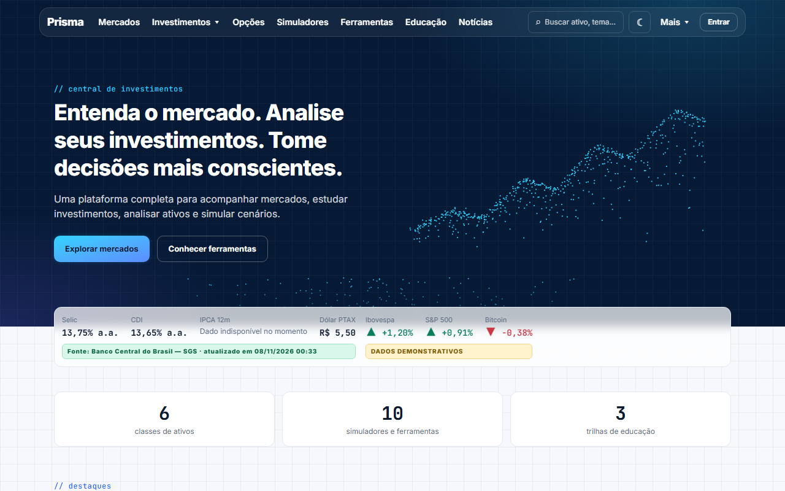
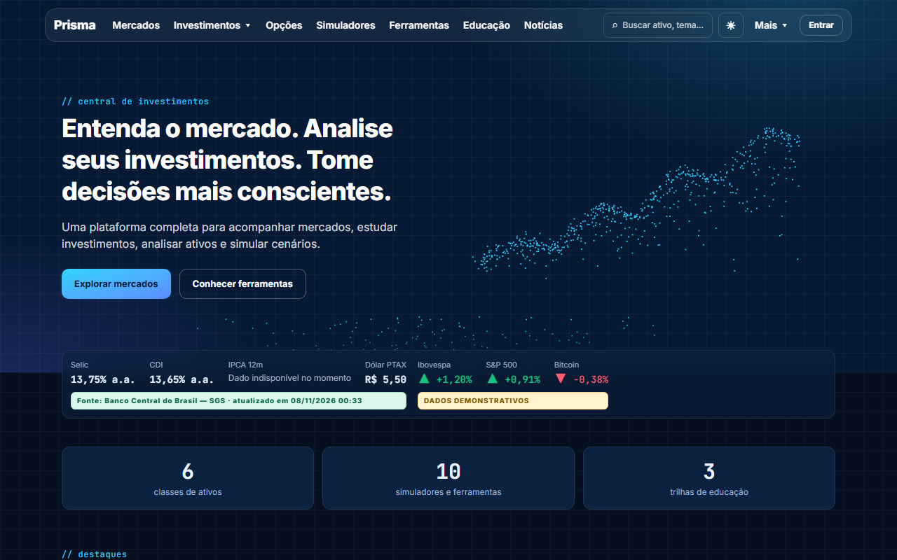
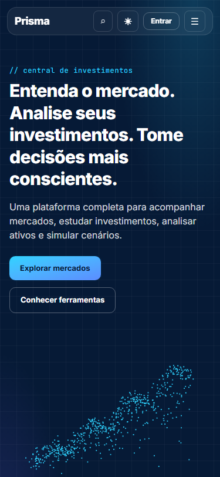

# Prisma

Plataforma web em português para acompanhar mercados, estudar investimentos, analisar ativos e simular cenários. Projeto pessoal, de estudo e de portfólio. O nome "Prisma" é provisório e vive só em `siteConfig.name`.

> **Aviso:** As informações disponibilizadas nesta plataforma possuem finalidade educacional e informativa. Simulações e análises não constituem recomendação individual de investimento. Rentabilidade passada não garante resultados futuros. Investimentos envolvem riscos.

## Prints

Home no modo claro e no modo escuro (desktop, 1280 px) e no celular (375 px):






Os prints foram capturados com Playwright contra `npm run start`. O selo **DADOS DEMONSTRATIVOS** nas cotações de Ibovespa, S&P 500 e Bitcoin é intencional (veja "Fontes de dados").

## O que tem na plataforma

- Home com indicadores do Banco Central (Selic, CDI, IPCA, PTAX) e cotações demonstrativas.
- Páginas de mercados e de ativos (ações, FIIs, ETFs, cripto e índices) com cotação, histórico e fonte exibida.
- Simulador de juros compostos e comparador de renda fixa (CDB, Tesouro Selic, LCI/LCA e poupança, com IR e custos).
- Simuladores da Fase 2A: inflação (poder de compra e correção pelo IPCA do Banco Central), aposentadoria e independência financeira (perpetuidade real, premissas rotuladas) e financiamento (SAC e Price lado a lado, com amortização extra). Juros compostos e comparador também mostram valores em reais de hoje.
- Educação: 9 artigos em 3 trilhas (MDX). Busca global (Ctrl+K). Tema claro e escuro.
- Páginas legais, SEO (metadados, sitemap, JSON-LD, imagens Open Graph) e cabeçalhos de segurança.
- Rotas ainda não implementadas aparecem como "em construção" (carteira, opções, assistente etc.).

## Stack

Next.js 16 (App Router) · React 19 · TypeScript estrito · Tailwind CSS v4 (tokens CSS, `next-themes`) · Zod · Recharts (carregado sob demanda) · MDX · Vitest + Testing Library · Playwright + axe · npm · Vercel. A justificativa de cada escolha está em [docs/ARCHITECTURE.md](docs/ARCHITECTURE.md).

## Como rodar

Requisitos: Node 22 ou superior (`engines` no `package.json`) e npm.

```bash
npm install
cp .env.example .env.local   # opcional: todas as variáveis têm padrão
npm run dev                  # http://localhost:3000
```

Sem nenhuma variável, o site funciona: o Banco Central não exige chave e os ativos usam dados demonstrativos.

### Variáveis de ambiente

| Variável               | Obrigatória | Padrão                                                    | Para quê                                                                                                                                                          |
| ---------------------- | ----------- | --------------------------------------------------------- | ----------------------------------------------------------------------------------------------------------------------------------------------------------------- |
| `BRAPI_TOKEN`          | Não         | vazio                                                     | Token da [brapi.dev](https://brapi.dev). Com ele, cotações e histórico de ativos da B3 passam a ser reais. Só no servidor; nunca versione.                        |
| `BCB_BASE_URL`         | Não         | `https://api.bcb.gov.br`                                  | URL base da API do Banco Central. Útil para testes (apontar para um endereço inacessível).                                                                        |
| `NEXT_PUBLIC_SITE_URL` | Não         | domínio de produção da Vercel, ou `http://localhost:3000` | URL pública do site. Usada em canonical, sitemap, Open Graph e JSON-LD. Na Vercel, sem ela, vale `VERCEL_PROJECT_PRODUCTION_URL`; defina só para domínio próprio. |

Os valores reais ficam em `.env.local` (fora do git). O `.env.example` documenta cada variável.

## Scripts

| Comando                           | O que faz                                  |
| --------------------------------- | ------------------------------------------ |
| `npm run dev`                     | Servidor de desenvolvimento                |
| `npm run build` / `npm run start` | Build e servidor de produção               |
| `npm run lint`                    | ESLint                                     |
| `npm run typecheck`               | `next typegen && tsc --noEmit`             |
| `npm test`                        | Testes unitários e de componentes (Vitest) |
| `npm run test:watch`              | Vitest em modo contínuo                    |
| `npm run test:e2e`                | Testes E2E (Playwright + axe)              |
| `npm run format`                  | Prettier (grava)                           |
| `npm run format:check`            | Prettier (só confere, para CI)             |

## Como testar

```bash
npm run lint && npm run typecheck && npm test && npm run test:e2e
```

- **Unitários:** funções financeiras puras (`src/lib/finance`), camada de dados, formatação, segurança, SEO e componentes.
- **E2E:** o Playwright sobe `npm run build && npm run start` (ou reaproveita um servidor já aberto em `localhost:3000`). Dois projetos: desktop (1280 px) e celular (375 px). Cobrem navegação, simulador, comparador, busca, tema, `prefers-reduced-motion`, ausência de rolagem horizontal, acessibilidade (axe) e cabeçalhos de segurança.
- **O E2E deixa o Banco Central inacessível de propósito** (`BCB_BASE_URL=http://127.0.0.1:9`). Assim os testes verificam que o site continua de pé e mostra "Dado indisponível no momento" quando a fonte real falha. Se você reaproveitar um servidor já iniciado com o BCB acessível, alguns testes podem divergir; pare o servidor antes de rodar o E2E.

## Fontes de dados e a política de DADOS DEMONSTRATIVOS

| Fonte               | O que fornece                                                                                                      | Chave         |
| ------------------- | ------------------------------------------------------------------------------------------------------------------ | ------------- |
| Banco Central (SGS) | Selic, CDI, IPCA (mensal, 12 meses e histórico mensal), PTAX, TR. Dados reais, com cache de 1 h (histórico: 24 h). | Não           |
| brapi.dev           | Cotação, histórico e P/L de ativos da B3. Opcional; cache de 15 min.                                               | `BRAPI_TOKEN` |
| Demonstrativo       | Preço e histórico simulados (caminhada aleatória determinística).                                                  | Não           |

Regras (detalhes em [docs/API.md](docs/API.md)):

1. Dado demonstrativo **sempre** traz o selo `DADOS DEMONSTRATIVOS`.
2. O modo demonstrativo simula só preço e histórico. **Indicadores fundamentalistas nunca são simulados**: aparecem como "Dado não disponível".
3. Uma fonte real que falha mostra "Dado indisponível no momento". Ela **nunca** é trocada em silêncio por dado demonstrativo.
4. Um ativo atendido por fonte real (brapi) não ganha seções demonstrativas.
5. Todo dado de mercado carrega `DataMeta` (fonte, data, atribuição) e a tela mostra a fonte.

## Publicar (deploy)

Publicado em **https://prisma-b8wz.vercel.app** (Vercel, plano Hobby), a partir de `main` em https://github.com/fabiorlima3006-ux/prisma. Cada push em `main` gera um novo deploy.

1. **GitHub:** repositório `fabiorlima3006-ux/prisma`. O perfil exibido em `/contato` fica em `siteConfig.links.github` (`src/lib/config/site.ts`).
2. **Vercel:** em vercel.com, "Add New → Project" (ou vercel.com/new) e importar o repositório. O Next.js é detectado sozinho.
3. **Variáveis de ambiente** (Settings → Environment Variables):
   - `BRAPI_TOKEN` = opcional; sem ele os ativos ficam demonstrativos;
   - `NEXT_PUBLIC_SITE_URL` = opcional; sem ela, o build usa o domínio de produção que a Vercel informa (`VERCEL_PROJECT_PRODUCTION_URL`). Defina só se usar um domínio próprio.
4. **Redeploy** depois de mudar variáveis (elas entram no build).
5. Conferir `/sitemap.xml`, `/robots.txt` e o canonical de uma página.

## Lighthouse

Medição **local** (sem CDN, máquina de desenvolvimento Windows 11), em 2026-11-08: Lighthouse 13.6.0 (`npx lighthouse`) com o Chromium 158 do Playwright (`CHROME_PATH`), Node 26.13.0, `--form-factor=mobile` (emulação de celular e CPU 4x mais lenta, throttling simulado), contra `npm run build && npm run start`. Cada página teve 1 execução de aquecimento descartada e **5 execuções**, intercaladas entre as três páginas; a tabela mostra a **mediana** (entre parênteses, a faixa de Performance). O Banco Central estava acessível.

| Página                         | Performance  | Acessibilidade | Boas práticas | SEO | TBT (mediana) | LCP    | CLS |
| ------------------------------ | ------------ | -------------- | ------------- | --- | ------------- | ------ | --- |
| `/`                            | 92 (90 a 99) | 100            | 100           | 100 | 361 ms        | 0,92 s | 0   |
| `/acoes/petr4`                 | 89 (84 a 92) | 100            | 100           | 100 | 440 ms        | 0,92 s | 0   |
| `/simuladores/juros-compostos` | 88 (85 a 92) | 100            | 100           | 100 | 473 ms        | 0,77 s | 0   |

Acessibilidade, Boas práticas e SEO são da rodada anterior (mesmo código nesses aspectos); a Performance foi remedida em 2026-11-08 depois da última mudança, com o mesmo método.

Metas: Performance 90 ou mais; demais 95 ou mais. O que mudou: o Recharts só é baixado quando o gráfico chega perto da tela, a busca só é carregada no primeiro Ctrl/⌘+K e o hero, em telas menores que 768 px, desenha só o gráfico já formado (sem a animação). Na rodada anterior, com a animação também no celular, a Home tinha mediana 85 (83 a 98).

**A medição local oscila muito nesta máquina:** o ativo e o simulador não mudaram e caíram de 91 e 92 para 89 e 88 entre uma rodada e outra. A variação vem de uma tarefa longa de hidratação do React (580 a 640 ms com CPU 4x mais lenta) que aparece em parte das execuções. Os números definitivos devem ser **remedidos na URL publicada**, com CDN.

### No site publicado (2026-11-08)

Mesmo método (Lighthouse 13.6.0 desta máquina, celular, 1 aquecimento + 5 execuções intercaladas, mediana) contra https://prisma-b8wz.vercel.app:

| Página                         | Performance  | Acessibilidade | Boas práticas | SEO | TBT    | LCP    | CLS |
| ------------------------------ | ------------ | -------------- | ------------- | --- | ------ | ------ | --- |
| `/`                            | 84 (79 a 90) | 100            | 100           | 100 | 620 ms | 0,94 s | 0   |
| `/acoes/petr4`                 | 87 (83 a 88) | 100            | 100           | 100 | 511 ms | 0,96 s | 0   |
| `/simuladores/juros-compostos` | 85 (82 a 89) | 100            | 100           | 100 | 599 ms | 0,95 s | 0   |

**A meta de Performance 90 não é atingida no site publicado.** O LCP fica abaixo de 1 s; o que derruba a nota é o tempo de bloqueio (TBT), dominado pela hidratação do React. O throttling simulado escala o trabalho medido na CPU desta máquina, então o resultado também carrega a oscilação local; confira no PageSpeed Insights (pagespeed.web.dev), que roda nos servidores do Google. Reduzir o JavaScript do cliente fica para a Fase 2.

Durante a medição anterior apareceu uma violação de CSP (`eval`) silenciosa vinda do modo JIT do Zod 4; foi corrigida desligando o JIT (`src/lib/zod-setup.ts`).

## Limitações conhecidas

- **brapi (plano gratuito):** observado no site publicado em 2026-11-08: históricos de 6 meses e 1 ano são recusados para a maioria dos tickers (funcionam em `PETR4`, `VALE3`, `ITUB4` e `MGLU3`, os tickers de teste). Nesses casos, semana e mês vêm de 3 meses, a variação anual fica vazia e as abas 6M e 1A do gráfico mostram "Dado indisponível no momento". Consultas repetidas em sequência levaram a falhas temporárias por ticker (provável limite de requisições). Os avisos `provider.unavailable` nos logs da Vercel trazem o status HTTP.
- **Fundamentos:** pela brapi, só o P/L é mapeado. Os demais indicadores aparecem como "Dado não disponível". Cada ativo faz 3 requisições separadas por ticker.
- **Rate limit das rotas `/api/market/*`:** em memória, por instância (não é global em serverless; zera a cada cold start). Plano: Upstash Redis na Fase 2.
- **Comparador de renda fixa:** o estado não vai para a URL (o simulador de juros compostos vai). Voltar/avançar do navegador não ressincroniza o formulário do simulador.
- **Regras tributárias** (`src/lib/config/tax-rules.ts`): a carência de LCI/LCA foi extraída de um comunicado da B3 (LCI 6 meses, Res. CMN 5.215/2025); `verifiedAt` é uma data fixa e a custódia do Tesouro tem data de vigência incerta. Confira sempre na fonte oficial.
- **Colunas qualitativas** do comparador (liquidez, risco, FGC) vêm de uma tabela estática; a cobertura do FGC é descrita de forma qualitativa, sem limites em reais.
- **Cálculos** em `number` (ponto flutuante duplo), com arredondamento só na exibição: aceitável para simulação educativa. Aportes no fim do mês, dias úteis aproximados por 252/365. Valores nominais por padrão; "em reais de hoje" usa uma premissa de inflação informada (padrão: IPCA 12 meses do BCB), não uma previsão.
- **`/busca` é `noindex`** (diverge do spec, que a previa indexável): páginas de resultado interno são conteúdo raso e duplicado.
- **Privacidade:** os valores digitados nos simuladores podem aparecer na URL (para compartilhar) e são usados só para calcular a página; não são armazenados.
- **Fase 2A:** a independência financeira não modela IR nem custos; a correção pelo IPCA segue a convenção da ADR 17 e pode diferir levemente de outras calculadoras; o financiamento não inclui seguros, tarifas nem TR.
- **Contraste:** o contraste não textual das áreas dos gráficos empilhados não foi verificado por ferramenta.

## Documentação

- [docs/ARCHITECTURE.md](docs/ARCHITECTURE.md): camadas, fluxo de dados, definições de indicadores e decisões (ADRs).
- [docs/API.md](docs/API.md): rotas internas e fontes externas.
- [docs/DATABASE.md](docs/DATABASE.md): "sem banco no MVP" e o esquema planejado da Fase 2.
- [docs/ROADMAP.md](docs/ROADMAP.md): fases e pendências.
- Spec completo: `docs/superpowers/specs/2026-11-07-plataforma-investimentos-design.md`.
